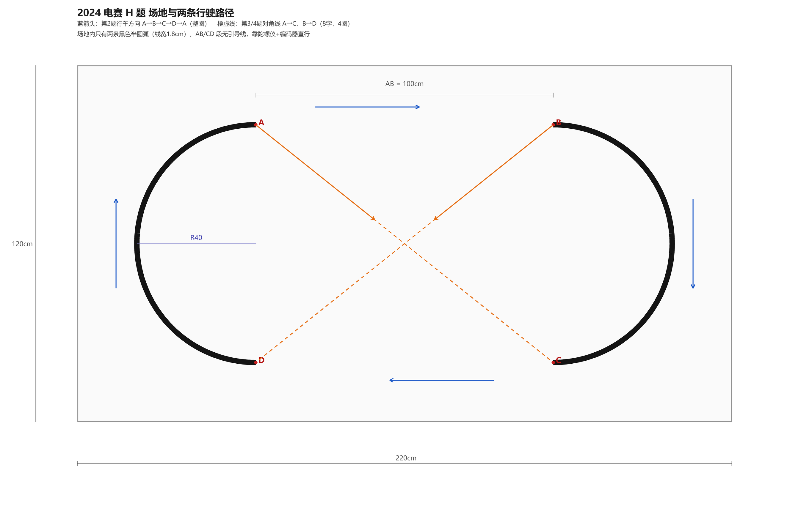
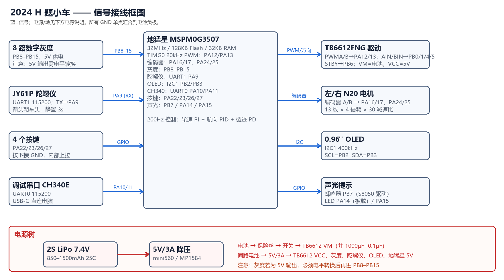

# 2024 电赛 H 题 · 自动行驶小车（立创·地猛星 MSPM0G3507）

> 一套**可以直接编译、按表接线、按步骤标定**的 H 题复刻方案。
> 主控使用你手上的立创·地猛星 MSPM0G3507；目标整车尺寸 20×13×9cm，满足题目 ≤25×15×15cm 的限制。



---

## 1. 题目要点（2024 H 题）

| 项目 | 要求 |
|---|---|
| 场地 | ≥220×120cm，白色哑光喷绘布；**只有两条 R=40cm 黑色半圆弧**，线宽约 1.8cm |
| 顶点 | A(60,100) B(160,100) C(160,20) D(60,20)（左下角为原点，单位 cm） |
| 第 1 题 | A→B 停车，声光提示，≤15s（20 分） |
| 第 2 题 | A→B→沿弧→C→D→沿弧→A，每过一点声光提示，≤30s（20 分） |
| 第 3 题 | A→C→沿弧→B→D→沿弧→A，每过一点声光提示，≤40s（30 分） |
| 第 4 题 | 第 3 题路线跑 4 圈，用时越短越好（30 分） |
| 硬性限制 | 只能前进不得后退；必须 TI MSPM0；不得装摄像头；长≤25 宽≤15 高≤15cm；车载电池 |

**关键认知**：AB、CD 和对角线 AC、BD 在地面上**没有线**，只有两段半圆弧是黑线。所以：
- 直线段靠 **陀螺仪航向 + 编码器里程** 走；
- 圆弧段靠 **8 路灰度循迹 + 陀螺仪切线方向** 走；
- 节点（A/B/C/D）靠 **里程计** 判定，而不是靠"扫到/扫不到线"——这是本方案与原版开源方案最大的区别，也是第 4 题能稳定跑完 4 圈的关键。

---

## 2. 方案要点

1. **两轮差速 + 万向轮**：转向时左右轮可以真正差速，不打滑，里程计准；比四驱履带式/四驱滑移转向更适合本题的 8 字。
2. **前馈 + 双闭环**：轮速 PI（内环，200Hz）+ 航向/循迹 PID（外环）；圆弧段用 `ω_ff = v/R` 做曲率前馈，PD 只修偏差。
3. **纯前进转向**：转向时内轮停在 0、外轮正转，绕内轮原地转，**任何时刻轮子都不反转**，满足"只能前进"。
4. **失线不死**：圆弧段丢线后按"陀螺仪切线 + 里程"继续走完已知的 180°，不会因为灰度短暂漏线就冲出场外。
5. **全流程状态机**：把四道题拆成 LINE / TURN / ARC 三类分段的表，段切换全部由里程触发；改题目只需要改表。
6. **可观测**：板载 CH340 输出 50Hz CSV 遥测，串口可在线改 PID；OLED 显示状态/传感器柱状图；4 个按键选题、发车、急停、翻页。

固件已经用本机 **TI Arm Clang 4.0.4 + MSPM0 SDK 2.11 + SysConfig 1.26** 完整编译链接通过（Flash ≈25KB / 128KB，RAM ≈4KB / 32KB），并用 `tools/path_check.py` 对四题路径做了几何自检（终点均落在 A/B，误差 0.00cm）。

---

## 3. 硬件清单（详细见 [docs/02_硬件与接线.md](docs/02_硬件与接线.md)）

| # | 物料 | 规格 / 关键词 | 数量 | 参考价 |
|---|---|---|---|---|
| 1 | 主控 | 立创·地猛星 MSPM0G3507（已有） | 1 | — |
| 2 | 电机驱动 | TB6612FNG 双路模块（或轮趣 D24A） | 1 | ¥15 |
| 3 | 电机 | N20 减速电机 6V 1:30 + 霍尔编码器 + 65mm 轮 | 2 | ¥80 |
| 4 | 底盘 | 2WD 亚克力/铝合金底盘 + 万向轮 | 1 | ¥40 |
| 5 | 灰度 | 8 路**数字量**灰度（间距 12–15mm，感为/自制） | 1 | ¥40 |
| 6 | 陀螺仪 | 维特 JY61P（UART，115200） | 1 | ¥60 |
| 7 | 显示 | 0.96" I2C OLED SSD1306 | 1 | ¥12 |
| 8 | 声光 | 有源蜂鸣器 + S8050 + 1k；3mm LED×2 + 1k | 1 套 | ¥3 |
| 9 | 按键 | 6×6 轻触 ×4 | 4 | ¥2 |
| 10 | 电池 | 2S 7.4V 850–1500mAh 25C LiPo + XT30 | 1 | ¥60 |
| 11 | 电源 | 5V/3A 降压模块（MP1584/mini560）、开关、1000µF、0.1µF | 1 套 | ¥15 |
| 12 | 结构 | 洞洞板、排针、铜柱、扎带、双面胶、激光笔（对准用） | 若干 | ¥30 |

> 总价约 ¥350–450。陀螺仪可换 HWT101（更稳，约 ¥150），第 4 题成绩会更好。



---

## 4. 快速开始

### 4.1 编译（不打开 CCS 也能编）

```powershell
powershell -ExecutionPolicy Bypass -File tools\build.ps1
```

脚本会自动找 SDK / SysConfig / TI Arm Clang，生成：

- `build\2024_H.out`（ELF，CCS/UniFlash 可烧）
- `build\2024_H.hex`（Intel HEX）
- `build\2024_H.map`（查看 Flash/RAM 占用）

如果路径不同，可显式指定：

```powershell
powershell -File tools\build.ps1 -Sdk "C:\ti\mspm0_sdk_2_11_00_07" -CcsRoot "D:\TI\CCS\ccs"
```

### 4.2 CCS 里打开

`firmware\` 目录本身就是 CCS 工程（`.project` / `.cproject` / `.ccsproject` / `2024_H.syscfg`）：

1. CCS → **File → Import Project** → 选择 `firmware` 目录；
2. 打开 `2024_H.syscfg` 可看到全部引脚；**若某个引脚与你的地猛星板载器件冲突，直接在 SysConfig 里改**，C 代码不用动；
3. Build → 烧录。

> 板载 CH340 走 UART0（PA10/PA11），插 USB-C 就能在电脑上看遥测，不需要额外 USB-TTL。

### 4.3 首次上电（务必按顺序）

1. **不装轮子**，只给主板上电：OLED 应显示开机画面，串口 115200 能看到 `$D,...` 数据。
2. 串口发 `m300,300`：两轮应**同时向前**；若某个轮反转，改 `board.h` 的 `MOTOR_L_INVERT/MOTOR_R_INVERT` 或对调该电机两根线；发 `n` 停止。
3. 手推小车前进，遥测里 `vL/vR` 应为正；否则改 `ENC_L_SIGN/ENC_R_SIGN`。
4. 把灰度条放在白纸上，8 路应全 0；压到黑线上，对应位变 1；确认 CH0 在最左侧。
5. 陀螺仪：车左转时 `yaw` 增大；否则把 `IMU_YAW_SIGN` 改为 `-1`。
6. 以上都对，再装轮子、上场地。

### 4.4 跑题

| 按键 | 功能 |
|---|---|
| K1 | 选题：1→2→3→4 循环（OLED 第一行显示 T:） |
| K2 | 发车 |
| K3 | 急停 |
| K4 | 切换显示页（状态 / PID / 灰度柱状图） |

摆放：第 1、2 题车头朝 **B**（沿 AB）；第 3、4 题车头朝 **C**（沿 AC，约 -38.66°）。发车后不要碰车。

---

## 5. 串口协议（115200 8N1）

50Hz 遥测（CSV，单位已缩放为整数）：

```
$D,<t_ms>,<task>,<state>,<seg>,<lap>,<s*10>,<yaw*10>,<vref*10>,<vL*10>,<vR*10>,<line_mm>,<dutyL>,<dutyR>,<seg_s*10>,<imu_frames>
```

调参命令（回车结束）：

| 命令 | 作用 |
|---|---|
| `1`…`4` | 直接启动对应题目 |
| `x` | 急停 |
| `z` | 当前航向清零 |
| `p` | 打印 PID 参数 |
| `h<kp>,<ki>,<kd>` | 改直线航向 PID |
| `l<kp>,<ki>,<kd>` | 改圆弧循迹 PID |
| `v<kp>,<ki>` | 改轮速 PI |
| `t<kp>` | 改转向 P |
| `m<l>,<r>` | 两轮开环占空比（-1600~1600，**调试用**） |
| `n` | 退出开环，停车 |

`tools/telemetry.py` 可以把串口数据存成 CSV 并画图（需要 `pyserial`，画图另需 `matplotlib`）。

---

## 6. 目录结构

```
2024_H/
├─ README.md                      ← 本文件
├─ firmware/                      ← CCS 工程 + 全部源码
│  ├─ 2024_H.syscfg               ← 引脚/外设配置（改引脚只改这里）
│  ├─ board.h                     ← 场地几何、机械参数、PID 默认值
│  ├─ main.c                      ← 初始化、按键、OLED 页面
│  ├─ mission.c/.h                ← 四题分段表 + 状态机（核心）
│  ├─ control.c/.h                ← 轮速环 / 航向环 / 循迹 / 转向
│  ├─ bsp_motor.c                 ← TB6612
│  ├─ bsp_encoder.c               ← 编码器四倍频
│  ├─ bsp_gray.c                  ← 8 路灰度
│  ├─ bsp_imu.c                   ← JY61P/WT61 串口解析
│  ├─ bsp_oled.c + font6x8.c      ← OLED 驱动与字库
│  ├─ bsp_ui.c                    ← 按键/蜂鸣器/LED
│  ├─ telemetry.c                 ← 遥测与在线调参
│  └─ startup_mspm0g350x_ticlang.c
├─ build/                         ← 编译产物（.out/.hex/.map）
├─ docs/
│  ├─ 01_方案设计.md              ← 题目解读、选型、机械、算法、误差分析
│  ├─ 02_硬件与接线.md            ← BOM、逐脚接线表、电源树、装配检查
│  ├─ 03_调试与标定.md            ← 从点灯到 4 圈的完整调试流程
│  ├─ 04_比赛现场手册.md          ← 赛前清单、场地制作、摆放、应急预案
│  ├─ 05_设计报告素材.md          ← 报告结构、摘要模板、测试表格
│  ├─ field_layout.png            ← 场地与路径图（可放进报告）
│  ├─ wiring.png                  ← 接线框图
│  ├─ path_check.txt              ← 几何/时间自检输出
│  ├─ control_sim.txt             ← 控制律仿真结果
│  └─ font_preview.png
└─ tools/
   ├─ build.ps1                   ← 一键编译
   ├─ path_check.py               ← 四题路径几何与时间自检
   ├─ control_sim.py              ← 圆弧/直线控制律仿真
   ├─ gen_field.py                ← 重新生成场地图
   ├─ gen_font.py                 ← 重新生成 OLED 字库
   └─ telemetry.py                ← 串口遥测/记录/画图
```

---

## 7. 参数速查（`firmware/board.h`）

| 宏 | 默认 | 说明 |
|---|---|---|
| `CAR_W_CM` | 12.0 | 左右轮中心距，**必须实测** |
| `WHEEL_D_CM` | 6.5 | 轮径，用来标定里程（实际走得偏短就调大） |
| `GEAR_RATIO` / `ENC_PPR` | 30 / 13 | 与你的 N20 编码器一致即可 |
| `COUNTS_PER_CM` | 自动算 | 76.4 counts/cm（13×4×30 / π6.5） |
| `SENSOR_AHEAD_CM` | 8.0 | 灰度条到轮轴的距离 |
| `GRAY_ACTIVE_HIGH` | 1 | 压黑线输出高=1 |
| `IMU_YAW_SIGN` | +1 | 左转 yaw 增大=+1 |
| `V_TASK1..4` | 32/36/36/58 | 各题巡航速度 cm/s |
| `GAIN_*_DEF` | 见文件 | PID 默认值，可用串口在线改 |

---

## 8. 已知限制与 honest disclaimer

- 固件**已通过编译与几何自检，但未在真实小车上跑过**；所有 PID、速度、转向参数都需要按 [docs/03_调试与标定.md](docs/03_调试与标定.md) 在实车标定。不同底盘/电机差异很大，默认参数只是合理起点。
- 数字灰度只有 8 个离散点，线卡在两只探头中间时会短暂"丢线"；本方案用陀螺仪+里程兜底，但**探头间距建议 ≤15mm**，且尽量让黑线始终压住至少一路。
- JY61P 长时间（>2min）有 0.5–2° 漂移；第 4 题跑 4 圈约 50s，影响可接受。追求更稳可换 HWT101 或加编码器航向融合。
- 地猛星板载 PA14(LED)、PA18(BSL 按键)、PA10/11(CH340)、PA19/20(SWD) 已被占用；本工程已避开。若你的板子版本不同，以 SysConfig 报错为准改引脚。
- 赛区对"车上是否有其他 MCU"的尺度不同：JY61P 内部有 MCU，多数赛区按传感器对待；若赛区极严，可换 MPU6050（I2C，纯传感器）并自行做姿态解算。

---

## 9. 从零到跑起来（一页纸）

| 步骤 | 做什么 | 参考 |
|---|---|---|
| 1 | 按 BOM 买件、按接线表焊接/插线 | [docs/02](docs/02_硬件与接线.md) |
| 2 | 编译：`powershell -File tools\build.ps1` | 本页 4.1 |
| 3 | 烧录：CCS / UniFlash / 立创工具 | 本页 4.2 |
| 4 | 不装轮子：电机方向、编码器、灰度、陀螺仪、OLED | [docs/03](docs/03_调试与标定.md) 第 1 章 |
| 5 | 标定轮径（跑 200cm 反算） | docs/03 1.3 |
| 6 | 第 1 题：直线停车 | docs/03 第 3 章 |
| 7 | 第 2 题：整圈 | docs/03 第 4 章 |
| 8 | 第 3 题：8 字 | docs/03 第 5 章 |
| 9 | 第 4 题：4 圈提速 | docs/03 5.2 |
| 10 | 打印现场手册，按流程比赛 | [docs/04](docs/04_比赛现场手册.md) |

**验收标准**（满足即达到"可参赛"）：

- [ ] `build\2024_H.out` 存在，烧录后 OLED/串口正常；
- [ ] 两轮前进方向一致，手推时 `vL/vR` 为正；
- [ ] 黑线压在哪一路，灰度柱状图对应位置亮；
- [ ] 陀螺仪左转 yaw 增大，静置 10s 漂移 <0.5°；
- [ ] 第 1 题 3 次都能停在 B，横向偏差 <3cm；
- [ ] 第 2 题连续 2 次整圈不脱线，<25s；
- [ ] 第 3 题连续 2 次 8 字回 A，<30s；
- [ ] 第 4 题 4 圈不出的概率 >70%，<70s。

> 未在实车验证前，请把本项目当作"经过编译与几何验证的工程起点"，而不是"保证拿奖的成品"。第 4 题的稳定性最终取决于装配精度、轮胎和陀螺仪。

---

## 10. 参考资料

- 2024 年 H 题题目原文（PDF）：[H题_自动行驶小车.pdf](https://github.com/colorcard/STM32Car_H/blob/master/H%E9%A2%98_%E8%87%AA%E5%8A%A8%E8%A1%8C%E9%A9%B6%E5%B0%8F%E8%BD%A6.pdf)
- 立创·地猛星 MSPM0G3507 文档中心：[wiki.lckfb.com/zh-hans/dmx](https://wiki.lckfb.com/zh-hans/dmx/)
- 地猛星入门手册（LED/按键/串口/I2C 引脚）：[wiki.lckfb.com/zh-hans/dmx/beginner](https://wiki.lckfb.com/zh-hans/dmx/beginner/)
- 24 电赛 H 题解题杂谈（开源作者复盘，含失败教训）：[suffine-wiki](https://github.com/weigo6/suffine-wiki/blob/main/docs/notes/24%E7%94%B5%E8%B5%9BH.md)
- TI MSPM0G3507 产品页与 SDK：[ti.com](https://www.ti.com/product/MSPM0G3507)
